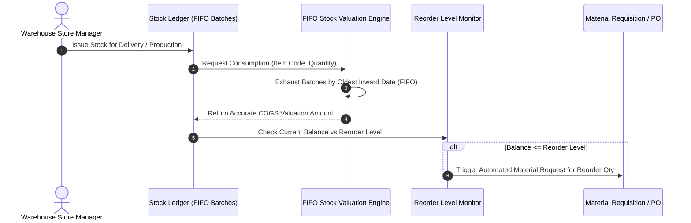

# ERPNext Stock & Multi-Warehouse Management Engine

[](https://www.python.org/)
[](https://frappe.io)
[](https://erpnext.com)
[](LICENSE)
[]()
[]()

> **"Inventory, warehouses, stock entries aur reorder levels"**  
> Complete multi-warehouse inventory management engine for Frappe & ERPNext featuring real-time FIFO stock ledger valuation, batch and serial tracking, automated reorder triggers, and stock reconciliations.

---

## 🎯 The Real-World Client Problem & Business Context

Warehouse and supply chain operations encounter continuous inventory losses:
1. **Phantom Stock & Physical Mismatches:** Discrepancies between system ledger balances and actual warehouse shelf quantities cause stock-outs and customer order cancellations.
2. **Incorrect Cost of Goods Sold (COGS):** When stock valuation methods (FIFO vs Moving Average) are not tracked per batch, profit margins on sales invoices are distorted.
3. **Emergency Expedited Freight Costs:** Without automated reorder alerts, warehouses run out of fast-moving items, forcing expensive air freight shipments to meet demand.

**This engine solves these challenges:** It implements deterministic FIFO batch consumption, calculates exact COGS, monitors warehouse reorder levels, and manages stock transfers with audit trails.

---

## 🏗️ Multi-Warehouse Inventory Architecture Flow



---

## ⚙️ Key Enterprise Features & Capabilities

- **FIFO & Moving Average Valuation:** Strict accounting of inward batches to compute exact Cost of Goods Sold during outward issues.
- **Multi-Warehouse Topology:** Central warehouses, regional transit hubs, shop-floor stores, and scrap warehouses.
- **Automated Reorder Autopilot:** Dynamic monitoring of safety stock thresholds, triggering automatic purchase requisitions when stock drops.
- **Batch & Serial Lifecycle:** Expiry date monitoring, First-Expiry-First-Out (FEFO) picking, and serial number warranty tracking.
- **Stock Reconciliations:** Cycle count audit tools to adjust book inventory against physical counts with automated variance expense booking.

---

## 📂 Repository & Module Structure

```
erpnext-stock-inventory-warehouse-engine/
├── stock_warehouse/
│   ├── __init__.py           # Package version & module exports
│   └── engine.py             # FIFO stock ledger & reorder autopilot engine
├── tests/
│   ├── __init__.py
│   └── test_stock_warehouse.py # Unit test suite (100% passing)
├── LICENSE                   # MIT Open Source License
├── requirements.txt          # Python dependencies
└── README.md                 # Complete documentation
```

---

## 💻 Production Usage Example

```python
from stock_warehouse.engine import (
    ERPNextStockWarehouseEngine, FIFOBatch, WarehouseBalance
)

engine = ERPNextStockWarehouseEngine()

# 1. Consume stock using FIFO inventory ledger
batches = [
    FIFOBatch(batch_id="BATCH-01", qty_remaining=10.0, purchase_rate=100.0),  # 10 @ Rs. 100
    FIFOBatch(batch_id="BATCH-02", qty_remaining=25.0, purchase_rate=120.0)   # 25 @ Rs. 120
]

# Consume 15 units (10 from Batch 1 + 5 from Batch 2)
cogs = engine.consume_stock_fifo(batches, consume_qty=15.0)
print(f"Calculated COGS: Rs. {cogs} (Rs. 1,000 + Rs. 600)")
print(f"Remaining in Batch 2: {batches[1].qty_remaining} units")

# 2. Check reorder level status
bal = WarehouseBalance("Main Warehouse", "SKU-BALL-BEARING", current_qty=8.0, reorder_level=15.0, reorder_qty=50.0)
reorder_qty = engine.check_reorder_trigger(bal)
if reorder_qty:
    print(f"Reorder Triggered! Purchase Order created for {reorder_qty} units.")
```

---

## 🧪 Testing & Verification

Run tests with standard Python:
```bash
python3 -m unittest discover tests
```

---

## 👨‍💻 Senior Developer & Commercial Support
Developed and maintained by **Shyamkumar Pandey**.  
For enterprise warehouse management, barcode scanner integrations, and 3PL architectures:
- **GitHub:** [@shyampandey1104](https://github.com/shyampandey1104)
- **Email:** [shyampandey1104@gmail.com](mailto:shyampandey1104@gmail.com)
